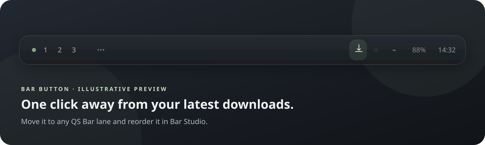
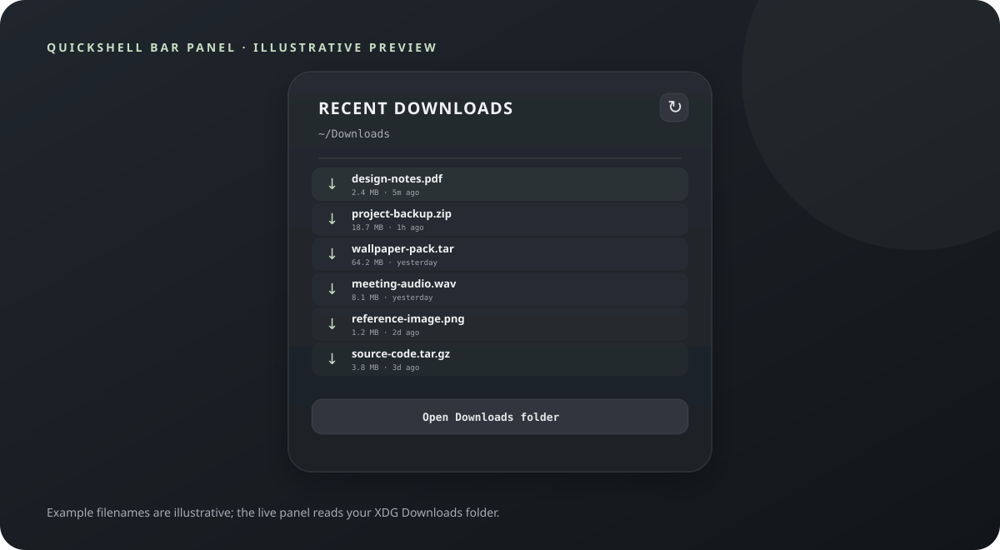

# Recent Downloads

<p align="center">
  <strong>A quiet QS Bar button for the files you just downloaded.</strong><br>
  Open a recent file or jump straight to your Downloads folder.
</p>

<p align="center">
  
  
  
</p>

## Preview

<p align="center">
  
</p>

<p align="center">
  
</p>

These are polished vector UI illustrations rather than live desktop captures; the filenames, sizes, and timestamps shown are sample content. The real widget uses your active Ryoku theme colors and reads your actual Downloads folder.

## Features

- Minimal download button with the **Recent Downloads** tooltip.
- Popup lists up to ten completed files, newest first.
- Click a file to open it with your default application.
- Open the Downloads folder or refresh the list from the popup.
- Reads the XDG Downloads directory; falls back to `~/Downloads`.
- Skips hidden files, directories, and common partial-download files.
- Keeps placement under your control through QS Bar Layout.

## Install

### Install from GitHub

On Ryoku Linux, run:

```sh
ryoku plugin add https://github.com/mannish01/Recent-Downloads.git --bar --yes
```

This validates and installs the plugin, then enables it on the QS Bar. You can also install it from a local checkout:

```sh
git clone https://github.com/mannish01/Recent-Downloads.git
cd Recent-Downloads
ryoku plugin validate .
ryoku plugin add . --bar --yes
```

### Requirements

The plugin needs Python 3, `xdg-user-dir`, and `xdg-open`. They are commonly present on Ryoku. If they are missing on Arch Linux:

```sh
sudo pacman -S python xdg-user-dirs xdg-utils
```

No extra Python modules, network access, or elevated actions are used by the widget itself.

## Choose its position

The install command adds the button to the bar. To choose its lane and order, open **Bar Studio → Open QS Bar Settings → Layout**. Select **Recent Downloads**, move it to the left, center, or right lane, and reorder it with the layout controls. Ryoku saves that layout across restarts.

You can also move it from a terminal:

```sh
ryoku-shell bar move recent-downloads --section left
# use center or right instead, and add --index N to choose its order
```

To hide or show it, use the widget's visibility control in the same Layout page. To uninstall:

```sh
ryoku plugin remove recent-downloads
```

## Use

Click the bar button to open the recent-file list. Click a file to launch it, use the refresh arrow to rescan, or choose **Open Downloads folder**. The list updates automatically when the popup opens and while it remains open.

## Privacy

The helper reads file names, paths, sizes, and modification times from your Downloads folder. It writes no files and contacts no network services. Opening a file or folder passes its path to `xdg-open` as a separate argument.

## Validate from source

```sh
ryoku plugin validate .
```

The source layout follows Ryoku's shell-plugin contract: `service/Main.qml` reads the list, `content/Widget.qml` draws the bar button, `content/Panel.qml` renders the popup, and `bin/recent-downloads` scans the XDG folder.
